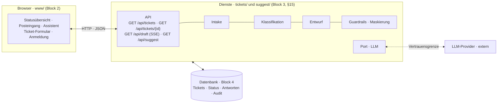
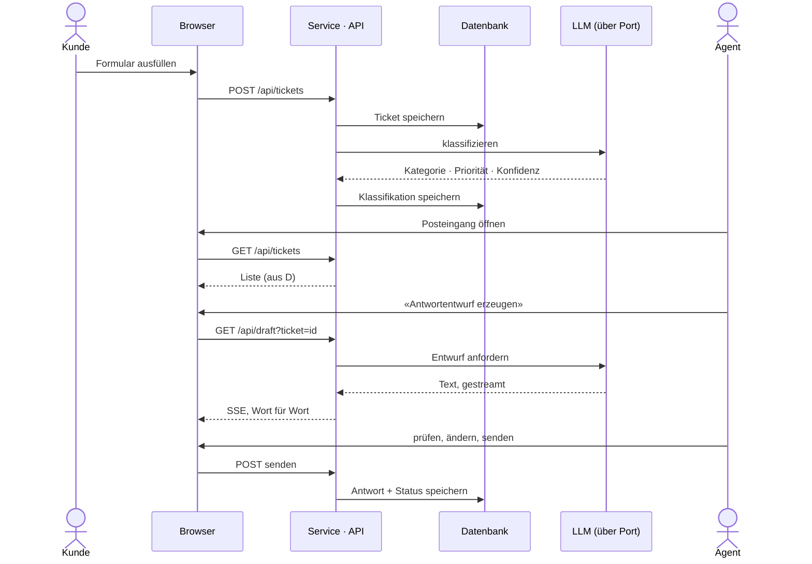
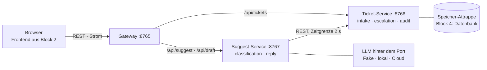

# SPEC.md · SupportFlow

> **Version 0.2 · Stand Block 1.** Was das System tun soll und warum — Ziel, Scope,
> Qualitätsziele, Anforderungen, Architektur-Entscheide, Guardrails. Für Menschen zuerst;
> die KI liest hier nach, wenn ein Auftrag darauf zeigt. **Wie** wir bauen, steht in `KONTEXT.md`.
> Der Frontend-Abschnitt kommt in Block 2 dazu (Abschnitt 14).

## 1. Ziel

SupportFlow nimmt Support-Anfragen kleiner und mittlerer Firmen entgegen,
**klassifiziert** sie mit einem LLM (Kategorie, Priorität, Konfidenz),
**schlägt** dem Support-Team eine Antwort **vor** und **eskaliert** unsichere
oder sensible Fälle an einen Menschen.

Zielgruppe: Support-Mitarbeitende im First Level; Support-Leitung.
Nutzen: ein kuratierter, priorisierter Posteingang statt roher E-Mail-Flut —
die KI entlastet Routine, **der Mensch entscheidet und sendet**.

MVP-Slice: Intake → Klassifikation → Antwortvorschlag (mit Freigabe) → Eskalation.

## 2. Scope

**Enthalten:** Ticket-Intake ohne Duplikate · LLM-Klassifikation (Kategorie,
Priorität, Sprache, Konfidenz) · LLM-Antwortvorschlag, nie automatisch gesendet ·
Eskalation bei niedriger Konfidenz oder sensibler Kategorie · minimales Dashboard.

**Nicht enthalten:** Ähnlichkeitssuche/RAG über frühere Fälle · Multi-Channel-Intake ·
Reporting-Dashboard · Self-Service-Bot · autonome Triage · Rollenmodell über ein
einfaches Login hinaus.

## 3. Qualitätsziele

Priorisiert — **bei Konflikten gilt diese Reihenfolge**:

1. **Datenschutz** — keine ungeprüften Kundendaten (PII) an externe LLM-Provider.
2. **Nachvollziehbarkeit** — jede KI-Entscheidung ist begründet und auditierbar.
3. **Wartbarkeit** — Kategorien, Schwellwerte und Regeln ändern sich im Betrieb;
   ein Modellwechsel darf nicht das halbe System betreffen.
4. **Testbarkeit** — die KI-Anteile müssen ohne Aufruf des echten Modells prüfbar sein.
5. **Performance** — das Einreichen wird sofort quittiert; die Analyse darf danach erfolgen.

## 4. Systemkontext

**Akteure:** Kundin oder Kunde (reicht Tickets ein, erhält Antwort) ·
Support-Mitarbeitende (prüfen und senden) · Support-Leitung (Policy, Kennzahlen).

**Nachbarsysteme:** ein **externer LLM-Provider** für Klassifikation und Antwortentwurf.

**Vertrauensgrenze:** Sie verläuft **zwischen Anwendung und LLM-Provider**.
Alles, was diese Grenze nach aussen überschreitet, gilt als veröffentlicht und ist
vorher zu maskieren. Alles, was von aussen zurückkommt — Klassifikation wie
Antwortentwurf —, gilt als **unvalidierte Eingabe** und wird geprüft, bevor es
Wirkung entfaltet.

## 5. Funktionale Anforderungen

**FR-1 · Ticket-Intake**
- Wenn ein Ticket eingereicht wird, dann entsteht genau **ein** Ticket mit ID,
  Zeitstempel und Status *Offen*.
- Wenn dieselbe Einreichung wiederholt wird, dann entsteht **kein zweites** Ticket.

**FR-2 · Klassifikation**
- Wenn ein Ticket eingegangen ist, dann werden **Kategorie** (ein Stichwort, z. B. Account,
  Abrechnung, Technisch, Reklamation), **Priorität** (tief | mittel | hoch), **vorgeschlagene Aktionen**
  und eine **Begründung** bestimmt (Vertrag: `Einschaetzung`). Der Status bleibt *offen*, die
  Einschätzung steht am Ticket. **Sprache** und **Konfidenz** (0–1) kommen mit Block 4 dazu.
- Wenn das Modell etwas Unbrauchbares liefert, dann bleibt das Ticket bearbeitbar —
  das System darf nicht stehen bleiben.

**FR-3 · Antwortvorschlag (Human in the Loop)**
- Wenn ein Ticket eingeschätzt und nicht eskaliert ist, dann erzeugt das LLM auf Anfrage einen
  **Antwortentwurf** — dieser wird **nie automatisch gesendet**.
- Dann muss ein Mensch den Entwurf **annehmen, überarbeiten oder ablehnen**, bevor
  eine Antwort das System verlässt.

**FR-4 · Eskalation**
- Wenn die Einschätzung «eskalieren» vorschlägt (sensible Anliegen: Rückerstattung, Beschwerde,
  Rechtsfrage, Drohung), dann wird das Ticket **ohne Antwortentwurf** als *eskaliert* markiert und
  einem Menschen zugewiesen. Ab Block 4 eskaliert zusätzlich eine Konfidenz unter der Schwelle.

**FR-5 · Dashboard**
- Wenn eine Person das Dashboard öffnet, dann sieht sie die Tickets nach **Priorität**
  mit Kategorie, Status, Antwortentwurf und kann annehmen / überarbeiten / eskalieren.

## 6. Nichtfunktionale Anforderungen (SMART)

| ID | Anforderung | Messgrösse / Prüfung |
|---|---|---|
| NfA-1 | Einreichen wird sofort quittiert | Rückmeldung < 300 ms (p95) |
| NfA-2 | Datenschutz | 0 ungefilterte PII-Felder in ausgehenden Prompts (Test-geprüft) |
| NfA-3 | Kostendeckel | Token-Budget pro Ticket und Tag; bei Überschreitung bleibt das System nutzbar |
| NfA-4 | Nachvollziehbarkeit | je Antwort rekonstruierbar: welches Modell, welcher Kontext, welche Kosten |
| NfA-5 | Klassifikationsqualität | Trefferquote ≥ 0.85 auf dem versionierten Testkorpus |

## 7. Rahmenbedingungen

- Kleines Team, ein Deployment-Ziel, kein eigener Betrieb rund um die Uhr.
- MVP-Volumen < 500 Tickets pro Tag.
- Kein eigenes Modell-Hosting; ein externer Provider wird eingekauft.

## 8. Architektur-Entscheide

Jeder Entscheid nennt das Qualitätsziel, aus dem er folgt, und seinen Preis.

**ADR-1 · Zwei Dienste hinter einem Eingang** *(revidiert in Block 3; in Block 1: modularer Monolith)*
*Folgt aus:* Wartbarkeit (3). Einschätzung und Antwortentwurf haben einen **eigenen Änderungsgrund**
(Modell, Prompt und Regeln ändern sich oft) und ein **eigenes Profil** (Sekunden statt Millisekunden,
Kosten je Aufruf) — anders als das Annehmen und Verwalten von Tickets.
*Entscheid:* Ein **Ticket-Service** (`intake`, `escalation`, `audit`) besitzt die Tickets; ein
**Suggest-Service** (`classification`, `reply`) spricht mit dem LLM. Davor ein **Gateway** als einziger
Eingang für den Browser (ADR-7). Innen bleibt jeder Dienst nach Fachlichkeit geschnitten. Die Tickets
gehören allein dem Ticket-Service; der Suggest-Service fragt ihn.
*Preis:* Jeder Aufruf zwischen den Diensten kann ausbleiben — Zeitgrenze und Plan für den Ausfall
sind Pflicht. Drei Prozesse statt einem. Ein Ablauf verteilt sich auf zwei Logs (Korrelation).
*Revidieren, wenn:* der Betrieb mehr kostet, als die getrennte Weiterentwicklung bringt — der fachliche
Schnitt erlaubt den Weg zurück. Kein Dienst je Tabelle: ein «Datenbank-Service» wäre nach Schicht
geschnitten (verteilter Monolith).

**ADR-2 · LLM-Zugriff nur über einen Port mit austauschbarem Adapter**
*Folgt aus:* Wartbarkeit (3) — Modellwechsel; Testbarkeit (4) — Prüfen ohne echtes Modell.
*Entscheid:* Die Fachlogik kennt eine Schnittstelle `Classifier` / `ReplyDrafter`,
nie einen Provider. Im Test tritt ein deterministischer Fake an die Stelle des Adapters.
*Preis:* eine zusätzliche Indirektionsebene; der kleinste gemeinsame Nenner der
Provider-Funktionen bestimmt die Schnittstelle.

**ADR-3 · Einschätzung asynchron, entkoppelt vom Einreichen** *(aus Block 1, in Block 3 auszuarbeiten)*
*Folgt aus:* Performance (5) — NfA-1 verlangt < 300 ms, ein LLM-Aufruf dauert Sekunden.
*Entscheid:* Das Einreichen schreibt das Ticket und quittiert sofort; die Einschätzung läuft
danach über eine Warteschlange. **Offen:** welche Nachricht welcher Dienst an wen schickt.
*Preis:* Tickets sind kurz ohne Einschätzung sichtbar — «offen» ist ein eigener Zustand, kein Fehler.
Fehlgeschlagene Einschätzungen brauchen einen Wiederholmechanismus.

**ADR-4 · PII-Maskierung als eigener Baustein vor dem LLM-Adapter**
*Folgt aus:* Datenschutz (1) — dem höchstpriorisierten Qualitätsziel.
*Entscheid:* Genau **eine** Stelle im System maskiert, und sie sitzt unmittelbar an
der Vertrauensgrenze. Kein Weg zum Provider führt daran vorbei.
*Preis:* **Zielkonflikt mit NfA-5** — maskierter Text kann schlechter klassifiziert
werden. Der Effekt ist auf dem Testkorpus zu messen, nicht zu vermuten. Bei
nachweisbarer Verschlechterung wird die Maskierung feiner, nicht schwächer.

**ADR-5 · Append-only-Audit-Log für jede KI-Entscheidung**
*Folgt aus:* Nachvollziehbarkeit (2), Messgrösse NfA-4.
*Entscheid:* Je Aufruf werden Modellkennung, Prompt-Fassung, Eingangsdaten in
maskierter Form, Ergebnis, Konfidenz und Kosten festgehalten. Einträge werden nie
verändert.
*Preis:* zusätzlicher Speicherbedarf; das Log enthält selbst schützenswerte Daten
und braucht eine Aufbewahrungsfrist.

**ADR-6 · Relationale Datenhaltung, kein Vektorspeicher**
*Folgt aus:* Scope — Ähnlichkeitssuche ist ausdrücklich nicht enthalten.
*Entscheid:* eine relationale Datenbank für Tickets, Klassifikationen und Audit-Log.
*Revidieren, wenn:* frühere Fälle genutzt werden sollen — dann kommt ein
Retrieval-Baustein hinzu, ohne die bestehende Datenhaltung zu ersetzen.

**ADR-7 · Ein Eingang für den Browser (Gateway)**
*Folgt aus:* Wartbarkeit (3) — das Frontend aus Block 2 kennt nur den Vertrag und eine Adresse.
*Entscheid:* Der Gateway auf Port 8765 liefert das Frontend aus und leitet `/api/…` an den zuständigen
Dienst weiter; Ströme reicht er durch, einen Abbruch gibt er weiter. Er enthält keine Fachlogik.
*Preis:* ein weiterer Prozess; fällt er aus, ist alles aus. Antwortet ein Dienst nicht, meldet er 503
in der Fehlerform.

**ADR-8 · Datenzugriff über einen Port — bis Block 4 eine Attrappe**
*Folgt aus:* Testbarkeit (4); die Datenbank kommt erst in Block 4.
*Entscheid:* Der Ticket-Service kennt nur die Schnittstelle `TicketSpeicher`. Heute steht eine Attrappe
im Arbeitsspeicher dahinter, in Block 4 eine relationale Datenbank (ADR-6).
*Preis:* Nach jedem Neustart sind nur die Beispieltickets da.

## 9. Design-Prinzipien

- **Fachlich schneiden, technisch verbinden.** Modulnamen benennen Fachlichkeit,
  nicht Schichten.
- **Kein LLM-Aufruf ausserhalb des Adapters.** Ein Aufruf an anderer Stelle ist ein
  Fehler, kein Sonderfall.
- **Kein irreversibler Schritt ohne Menschen.** Senden, Erstatten, Löschen.
- **Was die KI entscheidet, ist protokolliert.** Ohne Audit-Eintrag keine Wirkung.
- **Modellausgaben sind Eingaben.** Sie werden gegen ein Schema geprüft, bevor sie
  den Zustand des Systems verändern.

## 10. KI-Guardrails und Human in the Loop

| Regel | Typ | Durchsetzung | Erkennung im Log |
|---|---|---|---|
| Keine Antwort verlässt das System ohne menschliche Freigabe | Human in the Loop | Zustandsübergang nur über die Freigabe-Aktion | Versand ohne vorherige Freigabe |
| Keine Rückerstattung, keine Kontoänderung durch die KI | Autonomiegrenze | Diese Aktionen existieren als KI-Fähigkeit nicht | Aufruf einer nicht erlaubten Aktion |
| Keine ungefilterten PII an den Provider | Datengrenze | Maskierung im Baustein aus ADR-4 | ausgehender Prompt mit PII-Muster |
| Nur Daten des aktuellen Tickets im Kontext | Datengrenze | Kontext wird je Ticket zusammengestellt | fremde Ticket-ID im Prompt |
| Anweisungen im Ticket-Text sind Daten, keine Befehle | Injection-Schutz | Nutzertext getrennt vom Instruktionsteil | Ausgabe folgt Nutzeranweisung statt Systemvorgabe |
| Kostendeckel je Ticket und Tag | Betriebsgrenze | Zähler vor jedem Aufruf | Deckel erreicht, System weiter nutzbar |

## 11. Evaluation

- **Testkorpus, versioniert:** repräsentative Tickets mit erwarteter Kategorie und
  Priorität, darunter Fälle, die eskalieren müssen.
- **Vor und nach jeder Änderung gemessen:** Trefferquote (NfA-5), Precision und
  Recall der Eskalation, Latenz des Intake (NfA-1), Kosten je Ticket (NfA-3).
- **Eigens zu messen:** der Zielkonflikt aus ADR-4 — Trefferquote mit und ohne
  Maskierung.
- **Ohne echtes Modell prüfbar:** alle Zustandsübergänge, alle Guardrails, das
  Verhalten bei unbrauchbarer Modellantwort.

## 12. Annahmen und offene Fragen

- **Annahme:** MVP-Volumen < 500 Tickets pro Tag — keine Skalierungs-NfA nötig.
- **Offen:** Konfidenz-Schwelle für die Eskalation. Startwert **0.7**, zu kalibrieren.
- **Offen:** Liste sensibler Kategorien und Sperr-Schlüsselwörter, mit Legal abzustimmen.
- **Offen:** Aufbewahrungsfrist des Audit-Logs.

## 13. Glossar

**PII** — personenbezogene Daten. **HITL** — Human in the Loop: ein Mensch bestätigt
vor jeder irreversiblen Aktion. **Konfidenz** — vom Modell gemeldete Sicherheit
seiner Klassifikation (0–1). **ADR** — dokumentierter Architektur-Entscheid.
**NfA** — nichtfunktionale Anforderung, Qualitätsattribut.

---

## 14. Frontend (Block 2)

> Festgelegt von Werner Schäfer vor Block 2 (11.09.2026) als Vorarbeit — abgeleitet aus §2 Scope,
> §4 Akteure und §5 Anforderungen. Die technische Zielarchitektur skizziert der Mensch, nicht die KI.
> Abschnitte 1–13 stammen aus Block 1.

Fünf Bildschirme für drei Rollen — nur, was §2 einschliesst:

| Bildschirm | Rolle | Herleitung |
|---|---|---|
| Ticket-Formular | Kunde | FR-1 Ticket-Intake; Multi-Channel ist ausgeschlossen, also ein Formular |
| Anmeldung | alle | §2 «einfaches Login», kein Rollenmodell darüber hinaus |
| Posteingang | Support-Mitarbeitende | FR-5 «minimales Dashboard»: Tickets nach Priorität, Kategorie, Status |
| Assistent | Support-Mitarbeitende | FR-3 Antwortentwurf annehmen, überarbeiten, ablehnen; FR-4 eskalieren — Bereich im Posteingang, eigener Render-Entscheid (Streaming) |
| Statusübersicht | Support-Leitung | §4 «Kennzahlen», bewusst minimal: drei Zähler und die eskalierten Tickets. Kein Reporting-Dashboard (§2 ausgeschlossen) |

Kein Hilfe-Center: Self-Service ist in §2 ausgeschlossen. Render-Strategie je Bildschirm,
Zustand in der URL, Datenvertrag `Ticket = { id, titel, status, prio, text }`.
Heute gebaut: Statusübersicht (Demo), Posteingang (A5), Assistent (A8) — gegen den Mock-Service,
der die Endpunkte des späteren Services (Block 3) vorwegnimmt. Ticket-Formular und Anmeldung folgen nach Block 3: Sie brauchen
POST /api/tickets und ein Login, die der Mock nicht hat. Details und Abnahmekriterien: `KONTEXT.md`.

### 14.1 Zielarchitektur — technisch

**Stand Block 2:** Browser wird gebaut. Der Service ist durch einen **Mock** ersetzt
(`mock_assistent.py`, gleiche Endpunkte, Tickets im Speicher, Entwurf und Vorschläge als
fester Text). Datenbank und LLM-Provider existieren noch nicht.

### 14.2 Der Weg eines Tickets

### 14.3 Bauplan

**Bauplan (ADR, Block 2): API-first.** Der Vertrag (API-Schema) steht vor Service und Frontend.
Schritt ① Vertrag und Skelett (Block 1) · ② Frontend gegen Mock, Service und DB simuliert (Block 2) ·
③ Dienste statt Mock, Datenbank als Attrappe (Block 3) · ④ echte Datenbank (Block 4) · ⑤ Betrieb (Block 5). Konsequenz: Das
Frontend kennt nur den Vertrag, nie den Service direkt. Revision, falls der Vertrag sich je Bildschirm
ändern müsste.

## 15. Services (Block 3)

| Verbindung | Art | Warum |
|---|---|---|
| Browser → Gateway → Dienst | synchron, REST | der Mensch wartet auf die Antwort |
| Browser → Gateway → Suggest-Service (`/api/draft`) | synchron, Strom (SSE) | der Mensch liest mit, während das LLM schreibt |
| Suggest-Service → Ticket-Service | synchron, REST, Zeitgrenze | auf Knopfdruck (Einschätzen, Antwortentwurf) braucht er den Ticket-Text; die Tickets gehören dem Ticket-Service |

Die Einschätzung neuer Tickets läuft asynchron (ADR-3). Wer welche Nachricht an wen schickt, ist noch offen.

Starten: `./service.sh` (alle drei).
